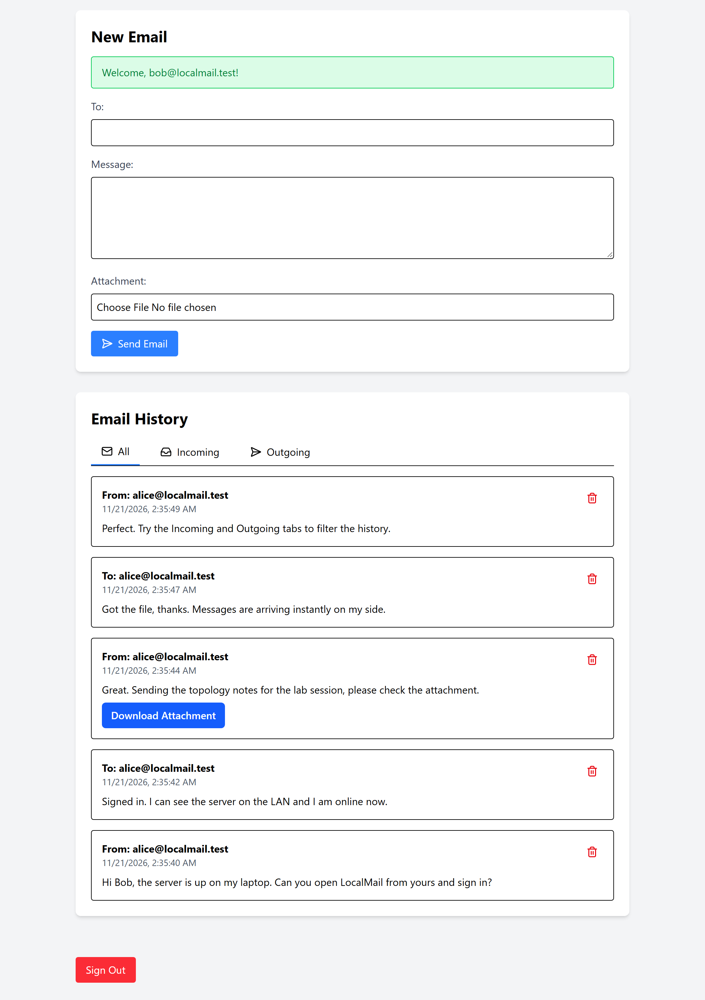
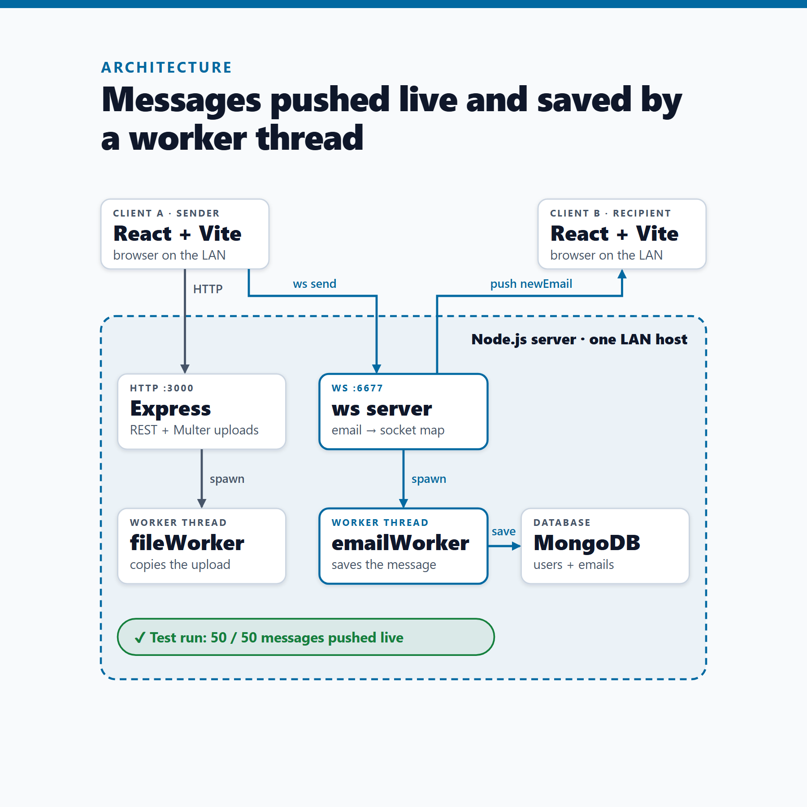

# LocalMail: Real-Time Messaging over a Local Network

LocalMail is an email-style messaging system that runs entirely on a local network, with no internet connection and no external mail server. Users on the same LAN sign in with an email address, send each other messages and file attachments, and see new messages arrive in real time. Messages are kept in MongoDB so the history can be read later.

<p align="center">
  
</p>

*Screenshot from a local run with demo accounts.*

## Architecture



| Part | What it does | Where |
|---|---|---|
| React client | Sign-in page and the mail dashboard (compose, history, filters) | `frontend/src` |
| Express REST API (port 3000) | Check user, register, list and delete messages, upload files | `backend/server.js` |
| WebSocket server (port 6677) | Registers each client's email, receives sends, pushes `newEmail` to the recipient and `sent` to the sender | `backend/server.js` |
| Email worker thread | Saves each message to MongoDB off the main event loop | `backend/workers/emailWorker.js` |
| File worker thread | Handles each uploaded file (copies it to `processed_<name>`) | `backend/workers/fileWorker.js` |
| MongoDB | Stores users and messages | `backend/models/emailSchema.js` |

### How a message travels

1. The client opens a WebSocket and sends its email address; the server keeps a map of email to socket.
2. If there is an attachment, the client uploads it over HTTP first and gets back a file path.
3. The client sends `recipient|message|attachmentPath` over the WebSocket.
4. The server starts an email worker thread, which saves the message to MongoDB.
5. The server pushes a `newEmail` event to the recipient (if online) and a `sent` confirmation to the sender.
6. Both clients refresh their history from the REST API. A client that loses its connection retries every 3 seconds.

## Features

- Email-based sign-in and registration
- Real-time delivery over WebSocket
- Persistent message history in MongoDB
- File attachments (Multer uploads, served from `/uploads`)
- Incoming, Outgoing and All filters
- Delete messages
- Automatic WebSocket reconnection
- Works across devices on the same local network

## Tech stack

- **Frontend:** React 19, Vite 6, React Router, Tailwind CSS 4, Lucide icons
- **Backend:** Node.js, Express, `ws`, Mongoose, Multer, `worker_threads`
- **Database:** MongoDB
- **Network:** LAN, HTTP and WebSocket

## REST API

| Method | Path | Purpose |
|---|---|---|
| POST | `/api/check-user` | Does this email exist? |
| POST | `/api/register` | Create a user |
| GET | `/api/emails/:email` | Messages sent or received by an email, newest first |
| DELETE | `/api/emails/:id` | Delete a message |
| POST | `/api/upload` | Upload an attachment (`multipart/form-data`, field `file`) |

## Run it

You need Node.js 18 or newer and a MongoDB server running on `127.0.0.1:27017`.

1. **Set the server address.** Replace `192.168.199.200` with the LAN IP of the machine that runs the backend, in both places:
   - `backend/server.js` (`SERVER_IP`)
   - `frontend/src/config.js` (`SERVER_IP`)

   For a single-machine test you can use `127.0.0.1` in both.

2. **Start the backend** (it must be started from the `backend` folder):

   ```bash
   cd backend
   npm install
   node server.js
   ```

3. **Start the frontend**, exposing it on the network so other devices can open it:

   ```bash
   cd frontend
   npm install
   npm run dev -- --host
   ```

4. Open the address Vite prints (for example `http://<server-ip>:5173`) on any device on the same network, register an email, and open a second browser or device with another email to send messages.

## Team

Built jointly for the Operating Systems and Networking module by:

- **Keshara Gunathilaka**
- **Kanishka Gunasinghe**

## License

Released under the [MIT License](LICENSE).
